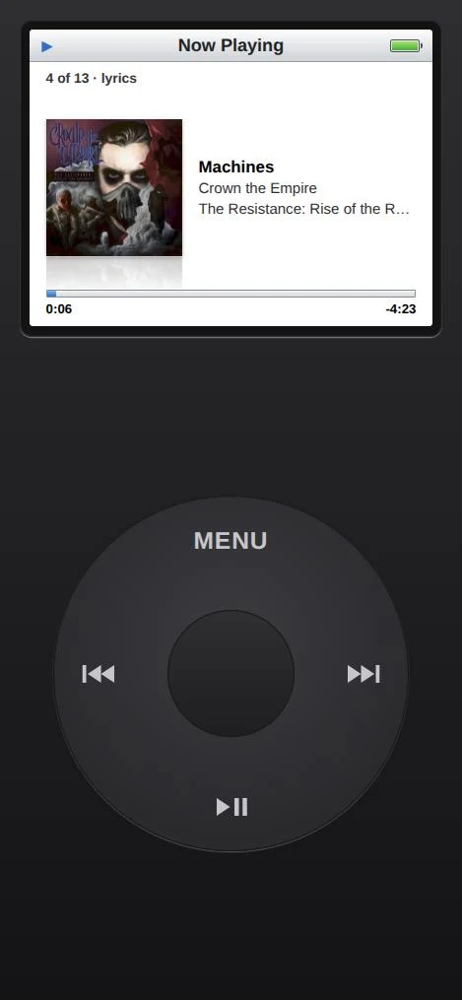

# Fretzpod

An iPod Classic-style music player for your Jellyfin library, as a web app. Click wheel, the old menus, Cover Flow, Now Playing, and three games in Extras. Add it to your phone's home screen and it runs full screen like an app.

> Built with Claude for my own server and shared as is. It works on my setup (Jellyfin 12.4, Android and iPhone, Chrome, Firefox and Safari). Issues and pull requests are welcome, and I'll update it as needed.

Inspired by the iPod Classic. Not affiliated with or endorsed by Apple.



## What it does

- **Click wheel** that tracks your thumb, with a click sound and a haptic tick on Android. On a computer, the arrow keys and the scroll wheel turn it.
- **The iPod menus:** Music (Cover Flow, Playlists, Artists, Albums, Songs, Genres, Favorites, Search), Shuffle Songs, Now Playing, Extras, Settings.
- **Cover Flow:** turn the phone sideways.
- **Now Playing:** the wheel is volume; press the center to scrub. Hold the center to favorite a song (Jellyfin's own favorites). Swipe sideways to flip the art over to the lyrics, when Jellyfin has them. Timed lyrics follow along; untimed ones scroll with your finger.
- **Keeps playing with the screen off** on Android, with lock screen controls. See DESIGN.md, "Playback", for how.
- **Extras:** Vortex (Brick in a circle), Space Sheep (Spacewar! with sheep) and Tiki Golf. Optional shared high score boards.
- **Optional extras:** TV (free channels from the Tuner Jellyfin plugin), and Speakers (play on Sonos speakers through Home Assistant).
- **Body colors:** silver, black, blue, red, purple.
- **Private:** no play reporting to Jellyfin, no access log, no analytics, nothing loaded from outside your server. See DESIGN.md, "Privacy".

Everyone signs in with their own Jellyfin account (Quick Connect or password) and sees only what that account allows.

## Install

You need Python 3 to build, and somewhere to serve it: Docker or Kubernetes (examples for both), or any web server you can point at the build.

**1. Settings.** Make a `site` folder and copy in the example for how you'll run it:

```bash
mkdir site
```

```bash
cp examples/docker/site.json site/
```

Edit `site/site.json`:

- `serverName`: shown on the sign-in screen ("Sign in to ...").
- `jellyfin.default`: your Jellyfin address as phones will reach it, for example `https://jellyfin.example.com`.
- `jellyfin.byHost` (optional): a different Jellyfin address for a particular address of Fretzpod. Use it when you open Fretzpod at home over plain http and want it to use Jellyfin's LAN address: `{"fretzpod.lan:8080": "http://192.168.1.10:8096"}`. An https page can't call plain http, so an https copy always needs Jellyfin's https address.
- `helpers` (optional): remove `scores` if you don't want shared high scores.

**2. Build:**

```bash
python3 build.py
```

This writes `build/` (the app, plus the nginx config with your settings filled in).

**3. Run it.**

With Docker Compose (nginx plus the high score service):

```bash
docker compose -f examples/docker/compose.yml up -d
```

Set `JF_URL` for the scores service in that file first. Then open `http://<that machine>:8080`.

With Kubernetes: copy `examples/kubernetes/site.json` and the manifests you want (`fretzpod.yaml`, plus `scores.yaml` and `speakers.yaml` for the optional helpers) into `site/`, adjust them, then:

```bash
./deploy.sh
```

**4. Make it reachable from outside (optional).** Put Fretzpod on an https address of its own (not a path under Jellyfin's address; see DESIGN.md, "How it fits together"). A reverse proxy or a tunnel such as Tailscale Funnel works.

### Jellyfin settings

- Turn on **Quick Connect** (Dashboard > General) so people can sign in without typing a password on their phone.
- Fretzpod asks Jellyfin to convert songs to AAC as they play, so Jellyfin needs transcoding allowed for those users.
- Lyrics show when Jellyfin has them (for example from the LrcLib plugin).

### TV (optional)

Install the Tuner plugin on your Jellyfin server. TV appears in the menu once the plugin answers. Channels only play from servers listed in `app/tv-hosts.json`.

### Speakers (optional)

Plays on Sonos speakers through Home Assistant, for the Jellyfin accounts you allow. It needs Kubernetes as written (`examples/kubernetes/speakers.yaml`), Home Assistant with the Sonos integration, and a Fretzpod address the speakers can download from. Fill in the values in `speakers.yaml`, set `helpers.speakers` in `site.json`, then make its Secret once:

```bash
JF_URL=http://192.168.1.10:8096 speakers/make-secret.sh
```

It asks for a Jellyfin admin API key (only to make its own key) and a Home Assistant token from a non-admin user. See DESIGN.md, "Speakers".

## Layout

| Path | What |
|---|---|
| `app/` | Everything the browser loads. Plain JavaScript modules, no build tools or npm. |
| `app/player.js`, `app/mp4mux.js` | The continuous stream player, and the MP4 rewrap Firefox and Safari need. |
| `app/ui.js`, `app/wheel.js`, `app/coverflow.js` | Screens and menus, the click wheel, Cover Flow. |
| `app/api.js`, `app/config.js` | Jellyfin calls and sign-in; the site settings (replaced by the build). |
| `app/vortex.js`, `app/spacesheep.js`, `app/golf.js`, `app/scores.js` | The games and the high score boards. |
| `app/tv.js`, `app/speakers.js` | The optional TV and Speakers. |
| `app/vendor/` | hls.js 1.7.3 (for TV), Apache 2.0. |
| `nginx/default.conf` | nginx config template with the Content Security Policy. |
| `build.py`, `deploy.sh` | Build for your site; deploy to Kubernetes. |
| `scores/`, `speakers/` | The optional helper services (Python standard library only). |
| `examples/` | Docker Compose and Kubernetes examples. |
| `dev/devserver.py` | Local test server. |
| `tools/sims/`, `tools/engines/` | Game balance checks; Playwright browser checks. |

## Development

`dev/devserver.py` serves `app/` on localhost and passes `/jf/*` through to Jellyfin with an API key, so you can try the UI without signing in. It also drops play reports.

```bash
JF_URL=http://192.168.1.10:8096 JF_TOKEN="$(cat ~/jellyfin-dev-key)" python3 -I dev/devserver.py 8769
```

Then in the page's console, browse as a user: `localStorage['fp.session'] = JSON.stringify({token: 'dev', userId: '<a Jellyfin user id>', name: 'dev'})`, and reload.

Dev-only hooks on localhost: `?stream=mp4` forces the MP4 stream path, `fpDebug.player` is the player, `fpDebug.ui()` the screen stack, `fpDebug.coverflow(true)` shows Cover Flow without rotating, `fpDebug.basic()` forces basic playback, `fpDebug.golf()` returns the open Tiki Golf game.

Gotchas:
- Audio only starts after a real click, not a synthetic event.
- Screen-off playback, the lock screen and haptics can only be tested on a real phone.

## License

MIT. See [LICENSE](LICENSE). hls.js is Apache 2.0 (`app/vendor/hls.LICENSE`).
