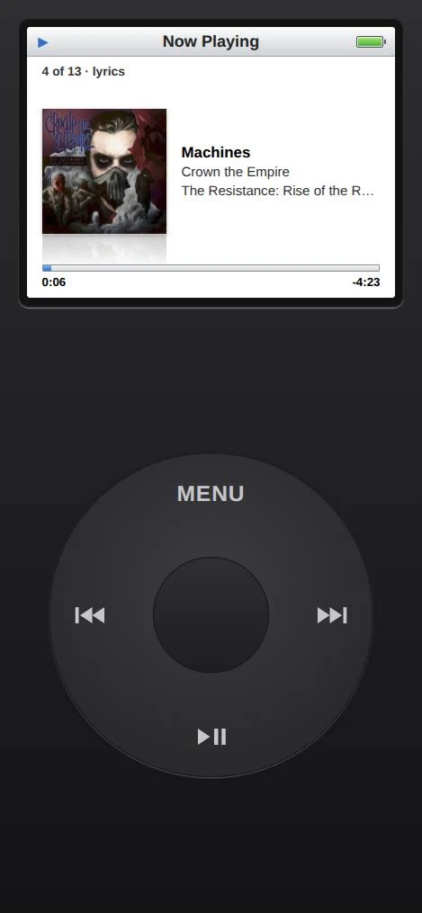
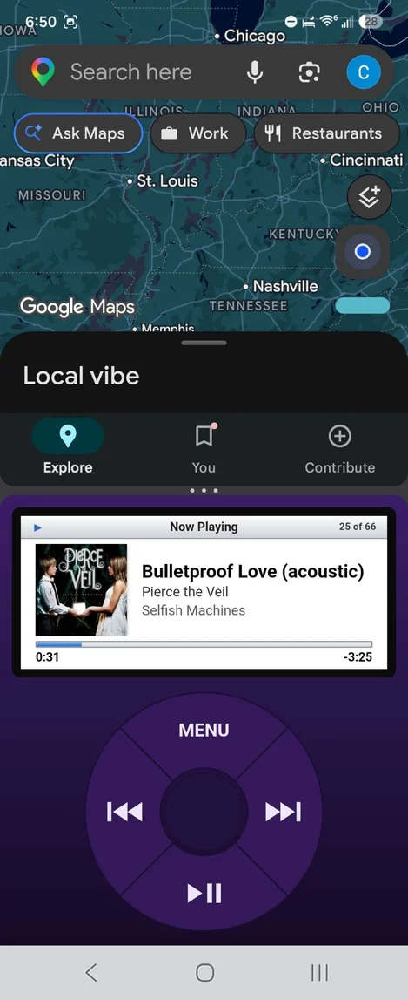
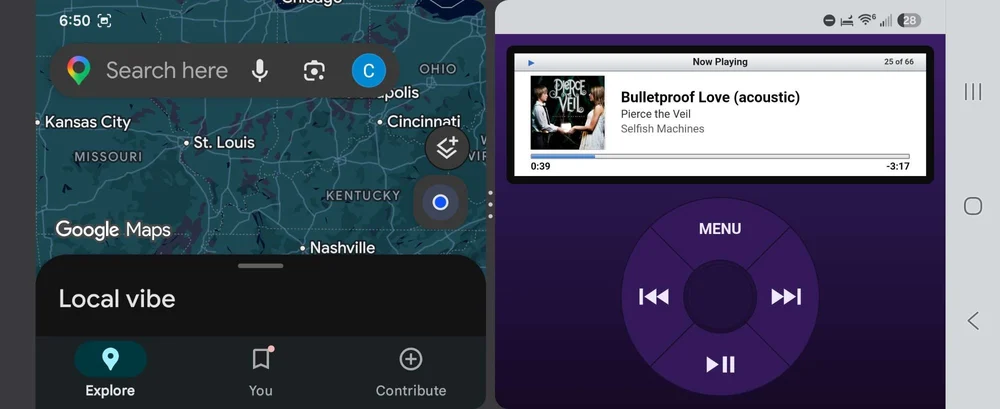

# Fretzpod

An iPod Classic-style music player for your Jellyfin library, as a web app. Click wheel, the old menus, Cover Flow, Now Playing, and three games in Extras. Add it to your phone's home screen and it runs full screen like an app.

> Built with Claude for my own server and shared as is. It works on my setup (Jellyfin 12.4, Android and iPhone, Chrome, Firefox and Safari). Issues and pull requests are welcome, and I'll update it as needed.

Inspired by the iPod Classic. Not affiliated with or endorsed by Apple.



## What it does

- **Click wheel** that tracks your thumb, with a click sound and a haptic tick on Android. On a computer, the arrow keys and the scroll wheel turn it.
- **The iPod menus:** Music (Cover Flow, Playlists, Artists, Albums, Songs, Genres, Favorites, Search), Shuffle Songs, Now Playing, Extras, Settings.
- **Cover Flow:** turn the phone sideways, or pick Music -> Cover Flow to flip through covers with the wheel with the phone upright (spin fast to jump a letter at a time; center turns a cover over to its songs). Albums with fewer than 4 songs (compilation one-offs) stay out of it; their songs are still under Artists, Songs and Genres.
- **Hold the center on a song, album, artist or playlist** for a menu: Play Next, Play Later, Instant Mix (Jellyfin's songs-like-this), Add to Playlist, Favorites, Go to Artist, Go to Album.
- **Now Playing:** the wheel is volume; press the center to scrub. Hold the center for the same menu as in the lists (Favorites, Instant Mix, Add to Playlist, Go to Artist, Go to Album); favorites are Jellyfin's own, and a small heart on the art shows one. Swipe sideways to flip the art over to the lyrics, when Jellyfin has them. Timed lyrics follow along; untimed ones scroll with your finger.
- **Keeps playing with the screen off** on Android, with lock screen controls. See DESIGN.md, "Playback", for how.
- **Extras:** Star Pinball (space pinball with three tables and five balls that open as your points add up; the flippers are ⏮ and ⏭), Fishing Trip (cast, hook and land fish with the wheel as the reel; three spots, four lures and a fish log) and Tiki Golf. Hold MENU in any game for the pause menu. Optional shared high score boards.
- **Optional extras:** TV (free channels from the Tuner Jellyfin plugin), and Speakers (play on Sonos speakers through Home Assistant).
- **In the car:** works over Bluetooth with song info and steering wheel buttons. **Car Mode** (Settings -> In the Car -> Enter Car Mode) turns the screen into big buttons for a phone on the dashboard: the iPod wheel cut into four buttons where its labels sit, Now Playing in large type, and a short menu (Shuffle Songs, Favorites, Playlists, Shuffle a Genre). On Android, put it in split screen next to Maps. For Android Auto and CarPlay themselves, Settings -> In the Car links to Jellify, a free Jellyfin app that has both.

  
  

- **Dark screen:** Settings -> Screen -> Mode: Light, Dark, Scheduled (dark between the Starts and Ends times you set) or Match Phone. Car Mode follows it too.
- **Art Screen:** Settings -> Art Screen: after 30 seconds or 2 minutes with no input while music plays, the screen shows just the album art on black and the wheel dims. The first touch only wakes it.
- **Sleep Mode** (off unless you turn it on): the whole screen goes black with only the time in dim gray, like a bedside clock, and the music keeps playing. Settings -> Sleep Mode -> Mode: By Hand (hold Play/Pause for about a second, like switching the old iPod off, or pick Sleep in the main menu) or Scheduled (also on its own between the Starts and Ends times, after a minute with no input; turn the wheel to set them, a quarter hour at a time, and center or MENU keeps the time). Play/Pause works even on the Art Screen; other buttons there only wake it. The screen stays on while it shows, through the scheduled hours, and while the lyrics are up (https copies only; browsers don't allow it on plain http).
- **Alarms** (Extras -> Alarms): an alarm that wakes you with Shuffle Songs, Favorites or a playlist, starting quiet and rising (once or every day, set in 5-minute steps), and a sleep timer (15 minutes to 2 hours, or the end of the song) that fades the music out. The alarm only rings with Fretzpod open and the screen on (Sleep Mode keeps it on), since a web page can't wake a phone; use the phone's Clock app for an alarm that has to work.
- **Body colors:** silver, black, blue, red, purple. Settings -> Wheel gives the wheel a color of its own (Original is the wheel the body came with), and Settings -> Selection changes the highlight color (the gold and clear prize bodies keep their own wheel, but take the highlight color). Plus prizes: a gold body for a huge lifetime total in each game, with that game's symbol pressed into the corner, and a clear case showing the insides for all three.
- **Private:** no play reporting to Jellyfin, no access log, no analytics, nothing loaded from outside your server. See DESIGN.md, "Privacy".

Everyone signs in with their own Jellyfin account (Quick Connect or password) and sees only what that account allows.

## Install

You need Python 3 to build, and somewhere to serve it: Docker or Kubernetes (examples for both), or any web server you can point at the build.

**1. Settings.** Make a `site` folder and copy in the example for how you'll run it:

```bash
mkdir site
```

```bash
cp examples/docker/site.json site/
```

Edit `site/site.json`:

- `serverName`: shown on the sign-in screen ("Sign in to ...").
- `jellyfin.default`: your Jellyfin address as phones will reach it, for example `https://jellyfin.example.com`.
- `jellyfin.byHost` (optional): a different Jellyfin address for a particular address of Fretzpod. Use it when you open Fretzpod at home over plain http and want it to use Jellyfin's LAN address: `{"fretzpod.lan:8080": "http://192.168.1.10:8096"}`. An https page can't call plain http, so an https copy always needs Jellyfin's https address.
- `helpers` (optional): remove `scores` if you don't want shared high scores.

**2. Build:**

```bash
python3 build.py
```

This writes `build/` (the app, plus the nginx config with your settings filled in).

**3. Run it.**

With Docker Compose (nginx plus the high score service):

```bash
docker compose -f examples/docker/compose.yml up -d
```

Set `JF_URL` for the scores service in that file first. Then open `http://<that machine>:8080`.

With Kubernetes: copy `examples/kubernetes/site.json` and the manifests you want (`fretzpod.yaml`, plus `scores.yaml` and `speakers.yaml` for the optional helpers) into `site/`, adjust them, then:

```bash
./deploy.sh
```

**4. Make it reachable from outside (optional).** Put Fretzpod on an https address of its own (not a path under Jellyfin's address; see DESIGN.md, "How it fits together"). A reverse proxy or a tunnel such as Tailscale Funnel works.

### Jellyfin settings

- Turn on **Quick Connect** (Dashboard -> General) so people can sign in without typing a password on their phone.
- Fretzpod asks Jellyfin to convert songs to AAC as they play, so Jellyfin needs transcoding allowed for those users.
- Lyrics show when Jellyfin has them (for example from the LrcLib plugin).

### TV (optional)

Install the Tuner plugin on your Jellyfin server. TV appears in the menu once the plugin answers. Channels only play from servers listed in `app/tv-hosts.json`.

### Speakers (optional)

Plays on Sonos speakers through Home Assistant, for the Jellyfin accounts you allow. It needs Kubernetes as written (`examples/kubernetes/speakers.yaml`), Home Assistant with the Sonos integration, and a Fretzpod address the speakers can download from. Fill in the values in `speakers.yaml`, set `helpers.speakers` in `site.json`, then make its Secret once:

```bash
JF_URL=http://192.168.1.10:8096 speakers/make-secret.sh
```

It asks for a Jellyfin admin API key (only to make its own key) and a Home Assistant token from a non-admin user. See DESIGN.md, "Speakers".

## Layout

| Path | What |
|---|---|
| `app/` | Everything the browser loads. Plain JavaScript modules, no build tools or npm. |
| `app/player.js`, `app/mp4mux.js` | The continuous stream player, and the MP4 rewrap Firefox and Safari need. |
| `app/ui.js`, `app/wheel.js`, `app/coverflow.js`, `app/carmode.js` | Screens and menus, the click wheel, Cover Flow, Car Mode. |
| `app/api.js`, `app/config.js` | Jellyfin calls and sign-in; the site settings (replaced by the build). |
| `app/pinball.js`, `app/fishing.js`, `app/golf.js`, `app/pause.js`, `app/scores.js` | The games, their shared pause menu and the high score boards. |
| `app/bodies.js` | The prize bodies: gold per game and the clear case. |
| `app/sleep.js` | The Art Screen and Sleep Mode. |
| `app/alarms.js` | The alarm and the sleep timer. |
| `app/tv.js`, `app/speakers.js` | The optional TV and Speakers. |
| `app/vendor/` | hls.js 1.7.3 (for TV), Apache 2.0. |
| `nginx/default.conf` | nginx config template with the Content Security Policy. |
| `build.py`, `deploy.sh` | Build for your site; deploy to Kubernetes. |
| `scores/`, `speakers/` | The optional helper services (Python standard library only). |
| `examples/` | Docker Compose and Kubernetes examples. |
| `dev/devserver.py` | Local test server. |
| `tools/sims/`, `tools/engines/` | Game balance checks; Playwright browser checks. |

## Development

`dev/devserver.py` serves `app/` on localhost and passes `/jf/*` through to Jellyfin with an API key, so you can try the UI without signing in. It also drops play reports.

```bash
JF_URL=http://192.168.1.10:8096 JF_TOKEN="$(cat ~/jellyfin-dev-key)" python3 -I dev/devserver.py 8769
```

Then in the page's console, browse as a user: `localStorage['fp.session'] = JSON.stringify({token: 'dev', userId: '<a Jellyfin user id>', name: 'dev'})`, and reload.

Dev-only hooks on localhost: `?stream=mp4` forces the MP4 stream path, `fpDebug.player` is the player, `fpDebug.ui()` the screen stack, `fpDebug.coverflow(true)` shows Cover Flow without rotating, `fpDebug.basic()` forces basic playback, `fpDebug.golf()` returns the open Tiki Golf game.

Gotchas:
- Audio only starts after a real click, not a synthetic event.
- Screen-off playback, the lock screen and haptics can only be tested on a real phone.

## License

MIT. See [LICENSE](LICENSE). hls.js is Apache 2.0 (`app/vendor/hls.LICENSE`).
